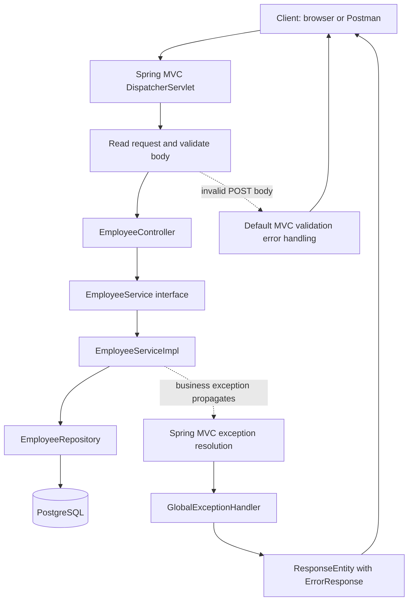
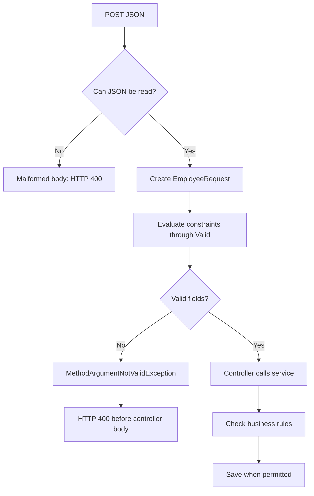
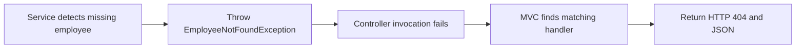
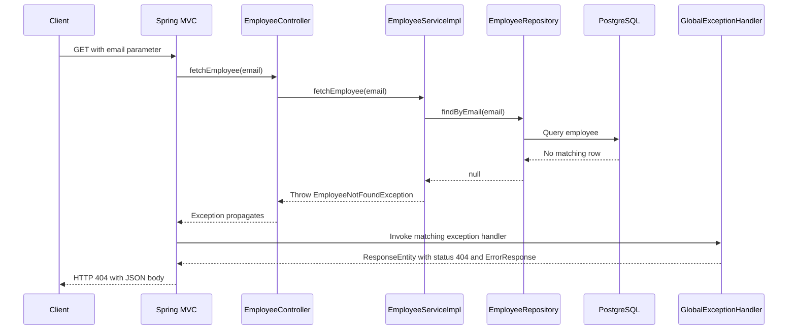
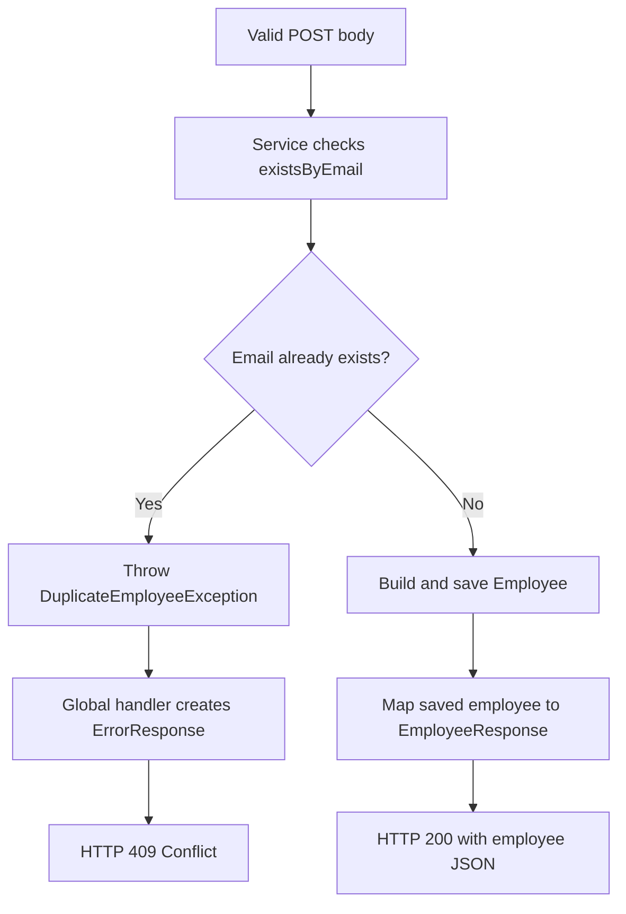

# Understanding validation and exception handling

These notes explain the employee API in this repository, including the corrected missing-employee lookup. Examples marked **proposed** are learning examples, not changes made to the application. HTTP examples describe expected behavior; they are not evidence of a live API test.

## 1. The problem these features solve

An employee request can fail for different reasons:

- The caller sends a blank name or an incorrectly formatted email.
- The caller requests an employee who does not exist.
- The caller tries to create an employee with an existing email.
- The database becomes unavailable.

These failures need different responses. A caller can correct invalid input, choose another email, or handle a missing employee. A database failure requires a different recovery path; telling the caller that the employee does not exist would be misleading.

| Mechanism | Responsibility | Example in this project |
|---|---|---|
| Validation constraints | Describe acceptable input | `@NotBlank`, `@Size`, `@Email` |
| Validation trigger | Ask the framework to check those constraints | `@Valid` on the POST request body |
| Custom exception | Give a failure a meaningful Java type | `EmployeeNotFoundException` |
| Exception handler method | Translate a failure into an HTTP response | `@ExceptionHandler(EmployeeNotFoundException.class)` |
| Global advice | Share exception handling across controllers | `@RestControllerAdvice` |
| Error response DTO | Define the data sent to the caller | `ErrorResponse` |

There is no special Java feature called `GlobalException`. `GlobalExceptionHandler` is the name chosen for a class in this project. Its Spring annotations give it its role.

## 2. Application architecture



The separate validation-error branch reflects the current code: global advice handles the two employee exceptions, but it does not yet define a validation handler.

| Layer | What it should know | What it does here |
|---|---|---|
| Controller | HTTP inputs and outputs | Accepts POST bodies and GET email parameters |
| Service | Employee business rules | Rejects duplicates and detects missing employees |
| Repository | Persistence operations | Looks up and saves employees |
| Database | Stored state and integrity constraints | Stores the `employees` table |
| Advice | HTTP representation of failures | Maps missing employee to 404 and duplicate to 409 |

The service throws a meaningful failure without having to construct JSON or select an HTTP status. This makes its behavior easier to reuse outside a controller.

## 3. Why use validation?

Validation rejects unsuitable input before the application tries to use it. For example, an empty first name should not proceed to employee creation.

The actual `EmployeeRequest` record declares:

| Field | Constraints | Meaning |
|---|---|---|
| `firstName` | `@NotBlank`, `@Size(min = 3, max = 10)` | Must contain non-whitespace text and have length 3–10 |
| `lastName` | `@NotBlank` | Must contain non-whitespace text |
| `email` | `@NotBlank`, `@Email` | Must contain text and satisfy email format validation |

The controller activates request-body validation here:

```java
public ResponseEntity<EmployeeResponse> addEmployee(
        @Valid @RequestBody EmployeeRequest employeeRequest) {
    EmployeeResponse employeeResponse = employeeService.addEmployee(employeeRequest);
    return ResponseEntity.ok(employeeResponse);
}
```

`@RequestBody` reads JSON into the DTO. `@Valid` requests validation. In this controller signature, invalid DTO fields cause `MethodArgumentNotValidException` before the controller method body runs. Spring's default handling returns HTTP 400. The details of MVC validation depend on the method signature; direct parameter constraints can instead cause `HandlerMethodValidationException`. See [Spring MVC validation](https://docs.spring.io/spring-framework/reference/web/webmvc/mvc-controller/ann-validation.html).



### Important distinctions

- `@NotNull` only rejects null; it permits an empty string.
- `@NotEmpty` rejects null and empty values, but a string containing spaces is not empty.
- `@NotBlank` rejects null, empty, and whitespace-only strings.
- `@Size` checks length; it does not trim a value or make a value required by itself.
- `@Email` checks format; it does not verify mailbox ownership, deliverability, or uniqueness. Pairing it with `@NotBlank` makes the value required.
- Constructing a record with `new EmployeeRequest(...)` does not automatically run Bean Validation.
- An annotation on the unused `EmployeeRequestDto` does not govern a controller that accepts `EmployeeRequest`.

The current email validation message says `Name is required`. That message is misleading for email. A future cleanup can change it to `Email is required`; this document does not modify it.

## 4. Input rules, business rules, and database rules

Consider `ravi@example.com`. Its format can be valid even when it already belongs to another employee.

| Question | Appropriate check | Current implementation |
|---|---|---|
| Is the first name blank? | DTO validation | `@NotBlank` |
| Is the email shaped like an email address? | DTO validation | `@Email` |
| Does this email already exist? | Service and repository | `existsByEmail(...)` |
| Does a requested employee exist? | Service and repository | `findByEmail(...)` and a null check |
| Can simultaneous inserts create duplicates? | Database uniqueness constraint | No email uniqueness mapping is declared in the inspected entity |

A service existence check alone cannot guarantee uniqueness under concurrency. Two requests can both see “email does not exist” before either saves. If uniqueness is required, enforce it in the database as well and translate the relevant constraint violation appropriately. An actual database may have constraints not represented in this source code.

## 5. Why create custom exceptions?

A custom exception names a particular failure so callers and handlers can react to its type.

Actual project example:

```java
public class EmployeeNotFoundException extends RuntimeException {
    public EmployeeNotFoundException(String message) {
        super(message);
    }
}
```

Line by line:

1. The class name expresses the failure: the employee was not found.
2. `extends RuntimeException` makes it an unchecked exception. Java does not require every caller to catch it or declare it with `throws`.
3. The constructor accepts details about this occurrence.
4. `super(message)` stores that message in the parent exception; the handler reads it with `ex.getMessage()`.

Throwing the exception stops the current normal execution path. The failure propagates through the calling methods until something handles it.



Using `RuntimeException("Employee not found")` for every failure would discard useful type information. Handlers should not need to inspect message strings to decide whether a failure is a missing employee or a duplicate employee.

Not every exception needs a custom type. Use one when it communicates a meaningful condition and supports distinct handling. Do not create a custom class merely to rename every infrastructure error.

## 6. Why use an exception handler?

An exception is a Java object, while an HTTP client needs a status and response body. A handler translates between them.

The current handler builds this response for a missing employee:

```java
@ExceptionHandler(EmployeeNotFoundException.class)
public ResponseEntity<ErrorResponse> hanldeEmployeeNotFoundException(
        EmployeeNotFoundException ex, HttpServletRequest request) {

    ErrorResponse errorResponse = ErrorResponse.builder()
            .timeStamp(LocalDateTime.now())
            .status(HttpStatus.NOT_FOUND.value())
            .error(HttpStatus.NOT_FOUND.getReasonPhrase())
            .message(ex.getMessage())
            .path(request.getRequestURI())
            .build();

    return ResponseEntity.status(HttpStatus.NOT_FOUND).body(errorResponse);
}
```

`@ExceptionHandler` selects the exception type. `ResponseEntity` sets the actual HTTP status and body. A JSON field such as `"status": 404` alone does not set the transport status. Spring MVC resolves exceptions through its exception resolver mechanism. See [Spring MVC exception handling](https://docs.spring.io/spring-framework/reference/web/webmvc/mvc-controller/ann-exceptionhandler.html).

The misspelling `hanlde` in the method name does not prevent handling. The annotation and method signature control this behavior.

## 7. Why make handling global?

Without shared advice, each controller could repeat the same response-building code. As more endpoints are added, those copies can develop different field names, messages, or status codes.

```java
@RestControllerAdvice
public class GlobalExceptionHandler {
    // Shared exception handler methods
}
```

`@RestControllerAdvice` combines controller advice with response-body behavior. It lets shared handler methods return response data such as JSON. See [Spring controller advice](https://github.com/spring-projects/spring-framework/blob/main/framework-docs/modules/ROOT/pages/web/webmvc/mvc-controller/ann-advice.adoc).

| Local controller handler | Global advice handler |
|---|---|
| Lives in one controller | Lives in a separate advice class |
| Useful for controller-specific handling | Useful for a shared error policy |
| Can duplicate logic across controllers | Centralizes common response construction |

Global advice keeps controllers focused on successful request processing and gives API clients a more consistent error contract. A frontend can display `message` while using the HTTP status to decide what action to take.

“Global” has a boundary: this is MVC request handling. It does not automatically catch startup failures, arbitrary background-thread failures, or all servlet-filter/security failures. It also does not handle an exception that application code catches and suppresses before it reaches MVC.

## 8. Complete missing-employee flow

Request:

```http
GET /api/v1/employees?email=missing@example.com
```



Illustrative body; the timestamp changes for each response:

```json
{
  "timeStamp": "2026-10-15T14:30:00",
  "status": 404,
  "error": "Not Found",
  "path": "/api/v1/employees",
  "message": "Employee not found with this email :missing@example.com"
}
```

The request URI supplies the path without the query string. The current timestamp uses `LocalDateTime`, so it contains no timezone offset.

## 9. The lookup bug and why the fix works

The earlier code used:

```java
try {
    Employee employee = employeeRepository.findByEmail(email);
} catch (Exception e) {
    throw new EmployeeNotFoundException("Employee not found with this email :" + email);
}
```

There were two problems:

1. The repository's single-entity lookup can return null when no row matches. No exception is thrown, so the catch block does not run.
2. A database failure enters the catch block and becomes `EmployeeNotFoundException`, incorrectly producing HTTP 404.

The corrected service checks the result explicitly:

```java
public void fetchEmployee(String email) {
    Employee employee = employeeRepository.findByEmail(email);
    if (employee == null) {
        throw new EmployeeNotFoundException("Employee not found with this email :" + email);
    }
}
```

| Repository outcome | Correct service behavior |
|---|---|
| Employee returned | Complete normally |
| Null returned | Throw `EmployeeNotFoundException` |
| Database exception thrown | Let the original failure propagate |

The current GET method returns `void`. A successful lookup therefore returns no employee JSON. Returning an `EmployeeResponse` would be a separate endpoint enhancement.

An **alternative design**, not implemented here, is to return `Optional<Employee>` from the repository and use `orElseThrow(...)`. The repository signature and callers must change together; `orElseThrow` cannot be called on the existing `Employee` return type.

## 10. Duplicate-employee flow



Both the missing-employee and duplicate-employee handlers use the same DTO structure, but choose different statuses and messages. That allows clients to process errors consistently while distinguishing their causes.

## 11. Current behavior versus proposed improvements

| Scenario | Current handling | Expected status |
|---|---|---|
| Valid POST with new email | Save and return employee DTO | 200 |
| Invalid POST field | Framework validation handling | 400 |
| Malformed JSON | Framework request-reading handling | Usually 400 |
| Existing email on POST | Custom duplicate handler | 409 |
| Missing employee on GET | Custom not-found handler | 404 |
| Existing employee on GET | Void method completes | 200 with no body |
| Missing required GET email parameter | Framework parameter handling | 400 |
| Database unavailable | Failure propagates; no dedicated handler here | Typically 500 |

The current GET `@RequestParam String email` has no `@Email` or `@NotBlank` constraints. POST DTO validation does not automatically validate that GET parameter.

Only the two custom employee exceptions currently have the project's `ErrorResponse` format. Do not assume every 400 or 500 response has that same structure.

### Proposed validation error response

For a frontend form, field-specific messages are more useful than a single generic sentence. A future validation DTO could include a list of field errors:

```json
{
  "status": 400,
  "error": "Bad Request",
  "message": "Request validation failed",
  "path": "/api/v1/employees",
  "fieldErrors": [
    { "field": "firstName", "message": "Name must be 3-10 characters" },
    { "field": "email", "message": "Enter valid email" }
  ]
}
```

This is a **proposed shape**, not the current response. A list preserves multiple violations for the same field. Avoid including rejected values for sensitive fields.

For this project's POST signature, a handler for `MethodArgumentNotValidException` can read `ex.getBindingResult().getFieldErrors()` and build the response. If direct method constraints are added later, account for the applicable method-validation exception too. See [Spring MVC validation](https://docs.spring.io/spring-framework/reference/web/webmvc/mvc-controller/ann-validation.html).

### Proposed unexpected-error handling

An unexpected server error should have a safe client message and detailed server-side diagnostics. Do not return raw database exception messages: they may reveal SQL or configuration details.

If adding a broad fallback handler, retain specific handling for expected MVC errors so malformed requests do not accidentally become HTTP 500. A fallback is a final policy choice, not a replacement for meaningful exception types.

## 12. What should be tested?

| Test | What it establishes |
|---|---|
| Missing repository result through controller and advice | HTTP 404 and the intended error body |
| Existing repository result | No false not-found exception |
| Repository throws a database exception | Service does not relabel an infrastructure failure as missing data |
| Invalid POST body | HTTP 400 and no service invocation |
| Duplicate email | HTTP 409 and no save |
| Successful POST | Employee response and expected persistence call |

`EmployeeNotFoundExceptionTests.java` was added for the first three cases. Its missing-employee test uses standalone MockMvc with the real controller, service, and advice, plus a mocked repository. It exercises MVC exception translation without a live database. It does not prove PostgreSQL connectivity or full application configuration.

The attempted test run was blocked because Maven could not access its configured local repository at `C:\.m2\repository`. The tests have not been confirmed passing. Once the Maven environment is fixed, run:

```sh
mvn -Dtest=EmployeeNotFoundExceptionTests test
```

## 13. Debugging guide

When the expected error response does not appear, trace the same flow as the application:

1. Confirm the request reaches the intended controller URL and HTTP method.
2. For POST validation, check that the actual request parameter has `@Valid` and that its DTO contains the constraints.
3. For missing employees, inspect the repository result. Null needs an explicit check.
4. Confirm the service actually throws the expected exception type.
5. Check whether another catch block suppresses or replaces that exception.
6. Confirm the advice is discovered by Spring and its annotation matches the exception.
7. Inspect both the actual HTTP status and the JSON body.

Useful breakpoints are the controller body, the service's null check, and the matching advice method. An invalid POST body should fail before entering the controller body. A missing employee should reach the service and then the not-found handler.

## 14. Questions for revision

**Does a custom exception automatically produce 404?** No. In this project, the handler chooses 404. Extending `RuntimeException` alone does not select an HTTP status.

**Does global advice prevent failures?** No. It translates failures that reach it into responses.

**Why not catch exceptions in every controller?** Repeating shared mappings increases maintenance work and makes consistency harder. Use local handling when a controller needs distinct behavior.

**Should the service catch every exception?** No. Catch when you can recover or translate a known failure accurately. A catch-all that reports “not found” loses the real meaning.

**Can validation replace business checks?** No. A correctly formatted email can still be a duplicate, and a correctly formatted lookup can still find no employee.

**Can DTO validation replace database constraints?** No. Other writers and concurrent requests can bypass application-level assumptions.

**Why have both a status field and an HTTP status?** The HTTP status controls protocol behavior. The body provides structured details for people and client applications. Keep them consistent.

**How do I view the diagrams?** Open this file in a Markdown viewer with Mermaid support, such as GitHub's rendered Markdown view. A viewer without Mermaid support will show the diagram source blocks.

## 15. Source map

- [EmployeeRequest](src/main/java/com/durgasoft/validation_service/dto/EmployeeRequest.java): POST input constraints.
- [EmployeeController](src/main/java/com/durgasoft/validation_service/controller/EmployeeController.java): HTTP entry points and `@Valid`.
- [EmployeeServiceImpl](src/main/java/com/durgasoft/validation_service/service/EmployeeServiceImpl.java): business checks and corrected lookup.
- [EmployeeRepository](src/main/java/com/durgasoft/validation_service/repository/EmployeeRepository.java): persistence signatures.
- [EmployeeNotFoundException](src/main/java/com/durgasoft/validation_service/exception/EmployeeNotFoundException.java): missing-employee failure type.
- [DuplicateEmployeeException](src/main/java/com/durgasoft/validation_service/exception/DuplicateEmployeeException.java): duplicate failure type.
- [GlobalExceptionHandler](src/main/java/com/durgasoft/validation_service/exception/GlobalExceptionHandler.java): shared HTTP error mappings.
- [ErrorResponse](src/main/java/com/durgasoft/validation_service/dto/ErrorResponse.java): current error response fields.
- [Regression tests](src/test/java/com/durgasoft/validation_service/EmployeeNotFoundExceptionTests.java): missing, existing, and database-failure cases.
