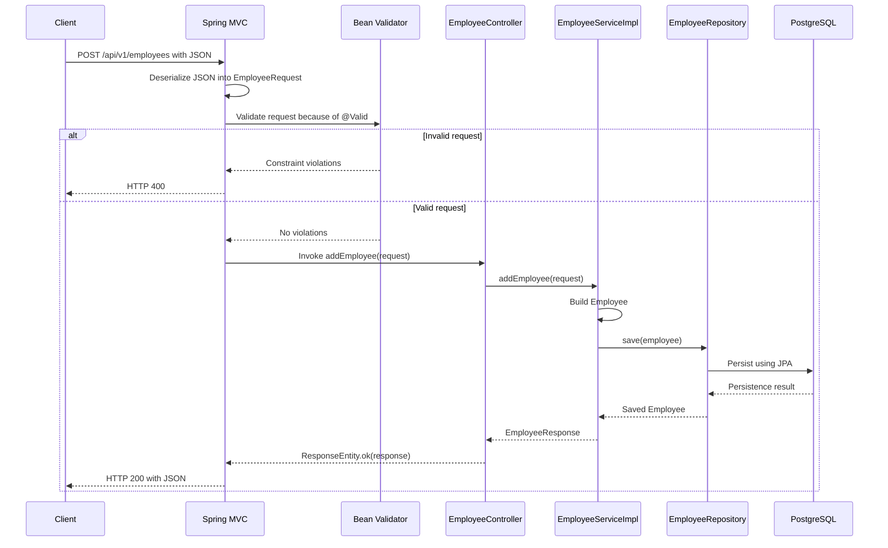

# Validation Service — Detailed Study Notes

These notes describe the current source code in this project. Examples of HTTP results explain expected behavior; they are not results from a live endpoint test. Earlier compilation attempts failed on the local Maven dependency setup.

## 1. What this project does

This Spring Boot application exposes an API to add an employee:

```http
POST /api/v1/employees
Content-Type: application/json
```

The application accepts employee details, validates them, saves an employee through Spring Data JPA, and returns an `EmployeeResponse` as JSON with HTTP `200 OK`.

Example request:

```json
{
  "firstName": "Ravi",
  "lastName": "Kumar",
  "email": "ravi@example.com"
}
```

Expected successful response, provided the database save succeeds:

```json
{
  "firstName": "Ravi",
  "lastName": "Kumar",
  "email": "ravi@example.com"
}
```

The database entity has an `id`, but the response record does not. Therefore, the API does not return the generated ID.

## 2. Project structure and responsibilities

All Java classes are under `src/main/java/com/durgasoft/validation_service`.

| File | Responsibility |
|---|---|
| `ValidationServiceApplication.java` | Starts Spring Boot. |
| `controller/EmployeeController.java` | Receives HTTP requests and returns HTTP responses. |
| `dto/EmployeeRequest.java` | Represents incoming data and declares validation rules. |
| `dto/EmployeeResponse.java` | Defines the fields returned to the client. |
| `dto/EmployeeRequestDto.java` | An alternative ordinary class; the current endpoint does not use it. |
| `service/EmployeeService.java` | Declares the employee service operation. |
| `service/EmployeeServiceImpl.java` | Builds the entity, saves it, and constructs the response. |
| `entity/Employee.java` | Represents the persisted employee. |
| `repository/EmployeeRepository.java` | Provides database operations through `JpaRepository`. |

The `pom.xml` declares Java 17 and Spring Boot parent version 4.1.1. Its main dependencies provide Spring MVC, Jakarta validation integration, Spring Data JPA, the PostgreSQL JDBC driver, and Lombok.

## 3. What is a Java record?

The response is declared as:

```java
public record EmployeeResponse(String firstName, String lastName, String email) {
}
```

A record is a concise Java class for carrying a fixed set of values. Its components produce private final fields, public accessor methods, a canonical constructor, and implementations of `equals`, `hashCode`, and `toString`.

For this record:

```java
EmployeeResponse response = new EmployeeResponse(
        "Ravi", "Kumar", "ravi@example.com");

String name = response.firstName();
String surname = response.lastName();
String email = response.email();
```

The accessor is `firstName()`, not `getFirstName()`. There is no generated setter and no generated zero-argument constructor. Records are implicitly final and cannot be extended. They can implement interfaces.

Records are shallowly immutable: component references cannot be reassigned, but a referenced mutable object could still change. This project's components are `String` values, which are themselves immutable. See [Java Record API](https://docs.oracle.com/en/java/javase/21/docs/api/java.base/java/lang/Record.html).

### Why the earlier response code failed

This does not match the declared record constructor:

```java
// Incorrect for this record:
EmployeeResponse response = new EmployeeResponse();
```

The current implementation correctly supplies all three components and returns the object:

```java
Employee respEmployee = employeeRepository.save(employee);

return new EmployeeResponse(
        respEmployee.getFirstName(),
        respEmployee.getLastName(),
        respEmployee.getEmail());
```

`respEmployee` is an ordinary entity class with Lombok-generated getters. The returned value is a record. That explains why this code uses `getFirstName()` while request mapping uses `employeeRequest.firstName()`.

### Request, response, and entity are separate types

| Type | Purpose | Accessor example | Used by |
|---|---|---|---|
| `EmployeeRequest` | Incoming values and input constraints | `firstName()` | Controller and service |
| `Employee` | Database representation, including ID | `getFirstName()` | Service and repository |
| `EmployeeResponse` | Outgoing API values | `firstName()` | Service and controller |

Keeping these types separate allows the database model and API output to change independently. Adding a field to the entity does not automatically expose it in the response.

## 4. Startup and dependency injection

The application starts with:

```java
SpringApplication.run(ValidationServiceApplication.class, args);
```

`@SpringBootApplication` enables application configuration, auto-configuration, and component scanning. The controller and service are below the application package, so they are within the normal scan scope.

Spring creates and connects these dependencies:

```text
EmployeeController
    needs EmployeeService
        implemented by EmployeeServiceImpl (@Service)
            needs EmployeeRepository
                supplied by Spring Data JPA
```

The controller uses constructor injection:

```java
private final EmployeeService employeeService;

public EmployeeController(EmployeeService employeeService) {
    this.employeeService = employeeService;
}
```

The service uses the same pattern for `EmployeeRepository`. A single constructor does not require `@Autowired`. The `final` field makes the dependency explicit and prevents reassignment after construction.

`@Service` is necessary here to register the implementation through component scanning. Implementing an interface alone does not register a Spring bean.

## 5. Complete request execution flow



### Step-by-step explanation

1. The client sends JSON with `Content-Type: application/json`.
2. Spring MVC matches the path from `@RequestMapping("/api/v1/employees")` and the HTTP method from `@PostMapping`.
3. `@RequestBody` causes an HTTP message converter to read the body and construct an `EmployeeRequest`.
4. `@Valid` requests validation of that argument before method invocation.
5. If validation succeeds, Spring calls the controller method. Only now does its `System.out.println` execute.
6. The controller invokes `employeeService.addEmployee(employeeRequest)`.
7. The service copies the request values into an `Employee` using its Lombok builder.
8. The service calls `employeeRepository.save(employee)`.
9. The service uses the returned entity to create an `EmployeeResponse`.
10. The controller wraps it in `ResponseEntity.ok(...)`.
11. Spring serializes the response body to JSON and writes the HTTP response.

If persistence throws an exception, execution does not proceed to the normal response construction. The success response is only returned when the service call completes normally.

## 6. Current validation rules

The endpoint uses this record:

```java
public record EmployeeRequest(
        @NotBlank(message = "Name is required")
        @Size(min = 3, max = 10, message = "Name must be 3-10 charecters")
        String firstName,

        @NotBlank(message = "Name is required")
        String lastName,

        @NotBlank(message = "Name is required")
        @Email(message = "Enter valid email")
        String email) {
}
```

The spelling and messages above match the source. The email blank message currently says `Name is required`; changing it to `Email is required` would make errors clearer.

| Field | Declared rules | Meaning in this API |
|---|---|---|
| `firstName` | `@NotBlank`, `@Size(min=3, max=10)` | Required, nonblank, length 3 through 10 inclusive. |
| `lastName` | `@NotBlank` | Required and nonblank; no size constraint is declared. |
| `email` | `@NotBlank`, `@Email` | Required, nonblank, and accepted by the provider's email format check. |

`@NotBlank` rejects null, empty, and whitespace-only text. `@Size` accepts null by itself; `@NotBlank` supplies the required-value rule here. `@Email` also accepts null by itself and does not verify mailbox existence. Exact email syntax acceptance is provider-dependent. Constraints do not promise execution in declaration order. See the [Jakarta Bean Validation specification](https://jakarta.ee/specifications/bean-validation/3.0/jakarta-bean-validation-spec-3.0.html).

### Examples based on these declarations

| Input variation | Expected validation result |
|---|---|
| `firstName: "Ravi"` | Passes both first-name constraints. |
| `firstName: "Ra"` | Fails the minimum size. |
| `firstName: "ABCDEFGHIJK"` | Fails the maximum size; this has 11 characters. |
| `firstName: ""` | Fails nonblank and minimum size. |
| `firstName: "   "` | Fails nonblank even though its length is 3. |
| `firstName: null` | Fails nonblank. |
| `lastName: "K"` | Passes; no minimum length is declared for last name. |
| `email: "not-an-email"` | Fails email format validation. |
| `email: null` | Fails nonblank. |

These annotations do not trim input or require alphabetic names. For example, `"123"` satisfies the current first-name rules. More restrictive business rules would require additional code or constraints.

## 7. Exactly when do validation annotations trigger?

The trigger for this HTTP endpoint is:

```java
public ResponseEntity<EmployeeResponse> addEmployee(
        @Valid @RequestBody EmployeeRequest employeeRequest)
```

Spring reads the request body and then applies Bean Validation to the resolved argument. With this method signature, validation failure produces `MethodArgumentNotValidException` and normally HTTP `400 Bad Request`. There is no adjacent `BindingResult` parameter to let the controller handle those errors itself. See [Spring MVC request body handling](https://docs.spring.io/spring-framework/reference/web/webmvc/mvc-controller/ann-methods/requestbody.html).

The important timing is:

```text
JSON conversion → request validation → controller method body
```

For an invalid request, this controller's log message will not appear, the service is not called, and this request does not reach `save`.

### An annotation is metadata, not a self-running check

Direct Java construction does not automatically execute these constraints:

```java
EmployeeRequest request = new EmployeeRequest("A", "", "wrong");
```

The record has no custom constructor validation, so this ordinary constructor call can create an invalid object. Explicit validation is possible using a configured Jakarta `Validator`:

```java
Set<ConstraintViolation<EmployeeRequest>> violations = validator.validate(request);
```

That API returns violations for the caller to handle. The HTTP path gets its automatic check from Spring MVC integration.

| Situation | Current behavior |
|---|---|
| HTTP request through this `@Valid @RequestBody` parameter | Request constraints are checked before the controller body. |
| Direct `new EmployeeRequest(...)` | No automatic Bean Validation call. |
| Direct Java call to `employeeService.addEmployee(...)` | No service-level validation is configured here. |
| Direct Java call to the controller method | Bypasses Spring MVC request argument processing. |
| `employeeRepository.save(employee)` | Does not validate the separate request record. Entity/database rules are separate. |
| Returning `EmployeeResponse` | No response validation constraints are declared here. |

Removing `@Valid` would remove this endpoint's automatic request Bean Validation step; JSON conversion would still occur through `@RequestBody`.

### Related concepts

`@Valid` also supports cascading into nested objects when placed on their properties. This request contains only strings, so there is no nested object graph to validate.

Spring's `@Validated` supports validation groups and is commonly used with configured service method validation. No such service validation setup appears in this project. MVC argument validation and service method validation are separate mechanisms. See [Spring MVC validation](https://docs.spring.io/spring-framework/reference/web/webmvc/mvc-controller/ann-validation.html).

## 8. Invalid JSON versus invalid field values

These are different failure stages:

| Problem | Stage | Typical result |
|---|---|---|
| Broken JSON syntax | Body conversion | HTTP 400, commonly `HttpMessageNotReadableException`. |
| Missing required request body | Body resolution | HTTP 400 before controller execution. |
| Valid JSON but short first name | Bean Validation | HTTP 400, `MethodArgumentNotValidException` for this signature. |
| Valid request but database failure | Repository operation | Exception path; no normal success response. |

For example, a trailing comma can prevent JSON parsing. Spring cannot validate an `EmployeeRequest` that it has not successfully constructed.

The project has no custom exception handler defining an error JSON contract. Do not assume the default HTTP 400 body includes every custom annotation message. The exact body depends on framework configuration. A future `@RestControllerAdvice` with an `@ExceptionHandler` could convert field errors into a consistent client-facing structure; that is not implemented here.

## 9. Service and persistence explained

The service contract is:

```java
public interface EmployeeService {
    EmployeeResponse addEmployee(EmployeeRequest employeeRequest);
}
```

The implementation performs three transformations:

```text
EmployeeRequest → Employee → saved Employee → EmployeeResponse
```

Its builder copies values; building an entity does not itself save it:

```java
Employee employee = Employee.builder()
        .firstName(employeeRequest.firstName())
        .lastName(employeeRequest.lastName())
        .email(employeeRequest.email())
        .build();
```

The repository extends `JpaRepository<Employee, Long>`. `Employee` is the managed entity type and `Long` is its ID type. Spring Data supplies the repository implementation.

| Entity annotation | Purpose in this project |
|---|---|
| `@Entity` | Marks `Employee` as a JPA entity. |
| `@Table(name="employees")` | Maps it to the `employees` table. |
| `@Id` | Identifies the primary-key field. |
| `@GeneratedValue(strategy=IDENTITY)` | Uses database identity generation for the ID. |
| `@Getter`, `@Setter` | Lombok generates access methods. |
| `@NoArgsConstructor` | Lombok supplies the no-argument constructor used by JPA. |
| `@AllArgsConstructor` | Lombok generates a constructor for all fields. |
| `@Builder` | Lombok generates the builder API used by the service. |

`application.properties` selects the PostgreSQL dialect, sets `ddl-auto=update`, and enables formatted SQL logging. Schema updates do not mean that request DTO validation becomes database constraints. No uniqueness rule for email is declared in the inspected entity; the actual database could have independently defined constraints.

The service has no explicit `@Transactional`. Standard inherited repository write operations provide transaction handling. If future business logic spans several repository operations that must succeed together, a service-level transaction boundary should be considered. SQL timing depends on persistence and transaction behavior; do not treat the Java `save` call as a universal promise of an immediate SQL statement in every JPA scenario.

## 10. How ResponseEntity works here

The controller contains:

```java
EmployeeResponse employeeResponse = employeeService.addEmployee(employeeRequest);
return ResponseEntity.ok(employeeResponse);
```

`ResponseEntity<EmployeeResponse>` describes an HTTP response whose body is an `EmployeeResponse`. It allows the controller to choose the status, headers, and body. The actual code chooses `200 OK` and supplies the service result as the body.

`@RestController` enables response-body handling. The DTO becomes JSON through HTTP message conversion; the application does not return the record's `toString()` output as the JSON response.

HTTP `201 Created` could be chosen in a future API contract revision, but the current implementation returns `200 OK`.

## 11. Manual practice requests

Start the application with a reachable PostgreSQL database and the configured credentials. If no external port override is supplied, Spring Boot's usual port is 8080. Set `baseUrl` in your API client to the actual running address, for example `http://localhost:8080`.

Use `POST {{baseUrl}}/api/v1/employees`, select a raw JSON body, and set `Content-Type: application/json`.

### Successful request

```json
{"firstName":"Ravi","lastName":"Kumar","email":"ravi@example.com"}
```

Expected: HTTP 200, three response fields, and an employee saved if the database operation succeeds.

### Name too short

```json
{"firstName":"Ra","lastName":"Kumar","email":"ravi@example.com"}
```

Expected: HTTP 400 before the controller body because the first name has fewer than three characters.

### Blank last name

```json
{"firstName":"Ravi","lastName":"   ","email":"ravi@example.com"}
```

Expected: HTTP 400 because last name fails `@NotBlank`.

### Invalid email

```json
{"firstName":"Ravi","lastName":"Kumar","email":"invalid-email"}
```

Expected: HTTP 400 because the email format is invalid.

Place breakpoints at the first controller statement, the service method, and `save`. A valid request should reach all three. A constraint failure should reach none of them. This makes the validation timing visible while debugging.

## 12. Common questions and mistakes

**Why are there annotations on both the DTO and the controller parameter?** The DTO declares rules; `@Valid` on the MVC parameter requests their evaluation for that request.

**Does a record make invalid values impossible?** No. This record has no validating constructor. Framework validation is a separate step.

**Why is the response constructed in the service?** The current design maps the saved entity to the outgoing DTO there, leaving the controller responsible for HTTP handling.

**Can annotations on `EmployeeRequestDto` affect this endpoint?** No. The method accepts `EmployeeRequest`; the unused class is not its argument type.

**Does `@Email` prevent duplicate emails?** No. Email syntax and uniqueness are different requirements. Uniqueness needs appropriate persistence/business rules.

**Does `@Valid` save data?** No. The repository call performs persistence.

**Does `@NotBlank` remove leading spaces?** No. It checks a condition; it does not normalize the value.

**Why might a client not see `Name is required`?** The violation message exists in validation results, but the default error response is not a guaranteed field-error API. Custom error handling can expose appropriate messages.

**What do the existing tests prove?** The only inspected test is a `@SpringBootTest` with `contextLoads()`. It does not explicitly test these validation cases, response JSON, or persistence behavior. These notes do not claim those checks passed.

## 13. Revision checklist

- Explain the roles of request DTO, entity, and response DTO.
- Write a record constructor call using every component.
- Distinguish `request.firstName()` from `entity.getFirstName()`.
- Trace JSON conversion, validation, controller, service, repository, and response serialization.
- Explain why the controller is not entered for a validation failure.
- Explain why direct object construction does not run Bean Validation automatically.
- Identify the rules actually present for each field.
- Distinguish HTTP input validation from database constraints.
- Explain why a method returning `EmployeeResponse` must return an object on its normal completion path.
